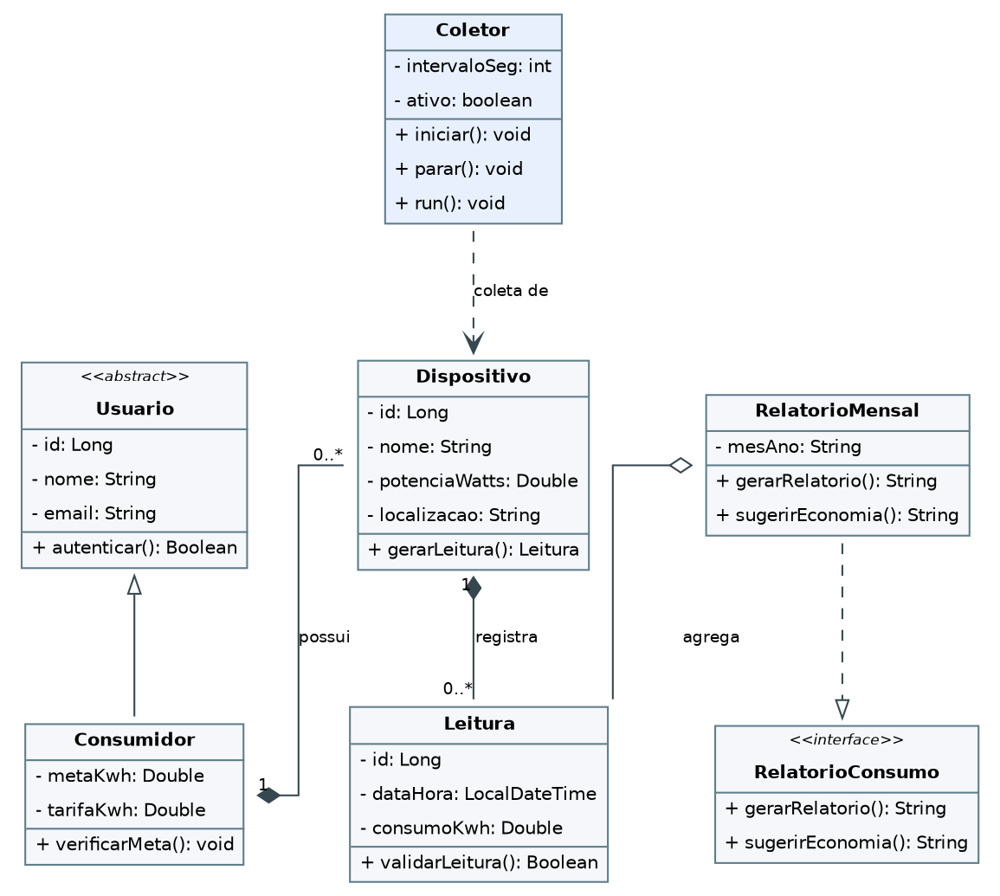

# Diagrama de Classes (UML)

Pontos que o diagrama demonstra (modelo da 1ª entrega):

- **Herança:** a classe abstrata `Usuario` é a base de `Consumidor`.
- **Composição 1:N:** um `Consumidor` possui vários `Dispositivos`; cada `Dispositivo` possui várias `Leituras`.
- **Polimorfismo:** a interface `RelatorioConsumo` (`gerarRelatorio()`, `sugerirEconomia()`) é implementada por `RelatorioMensal`.
- **Concorrência:** a classe `Coletor` coordena as threads que geram leituras periódicas.

> [!warning] Divergência com o código atual
> O código implementado usa [Aparelho](../03%20-%20Dom%C3%ADnio/Aparelho.md) (não `Dispositivo`), [Relatorios](../03%20-%20Dom%C3%ADnio/Relatorios.md) (não `RelatorioMensal`),
> e ainda não tem `Usuario`/`Consumidor`/`Coletor` como classes. Atualizar o diagrama ou registrar a decisão.
