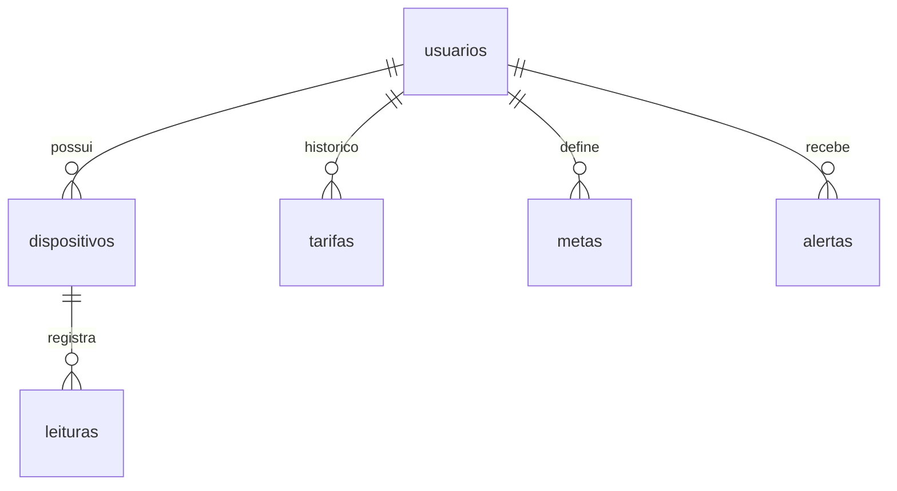

# DER

> [!warning] Desatualizado
> A imagem é da 1ª entrega. Faltam [tarifas](Tabelas/tarifas.md), [metas](Tabelas/metas.md), a coluna `leituras.horas_uso`
> e a troca de `tarifa_kwh`/`meta_kwh` de `usuarios` para essas tabelas.

## Modelo atual (`database/oracle/01_tabelas.sql`)

Todas as FKs usam `ON DELETE CASCADE`.

| Tabela | Descrição |
|---|---|
| [usuarios](Tabelas/usuarios.md) | Morador |
| [dispositivos](Tabelas/dispositivos.md) | Aparelhos do usuário |
| [leituras](Tabelas/leituras.md) | Medições (consumo calculado por trigger) |
| [tarifas](Tabelas/tarifas.md) | Histórico de tarifas |
| [metas](Tabelas/metas.md) | Uma meta por mês |
| [alertas](Tabelas/alertas.md) | Gravados pelos [Triggers](Triggers.md) |

Ordem dos scripts: `01_tabelas` → `02_triggers_views` → `03_procedimentos_app` → `dados_exemplo`.
