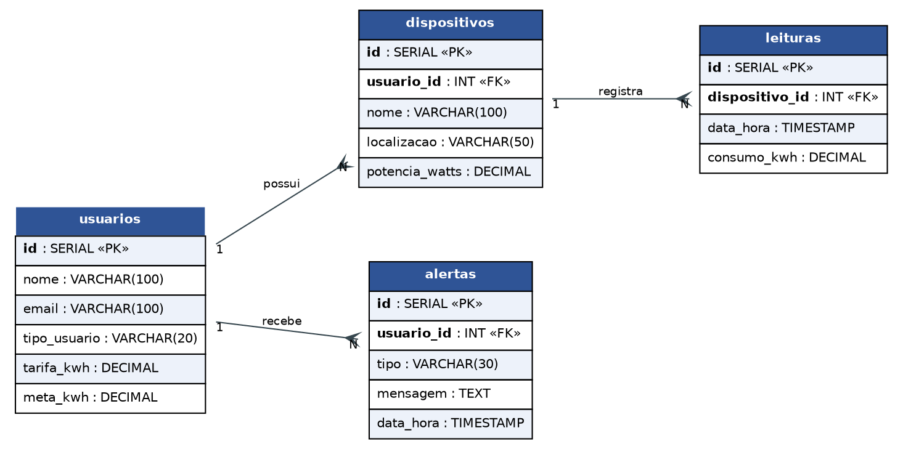
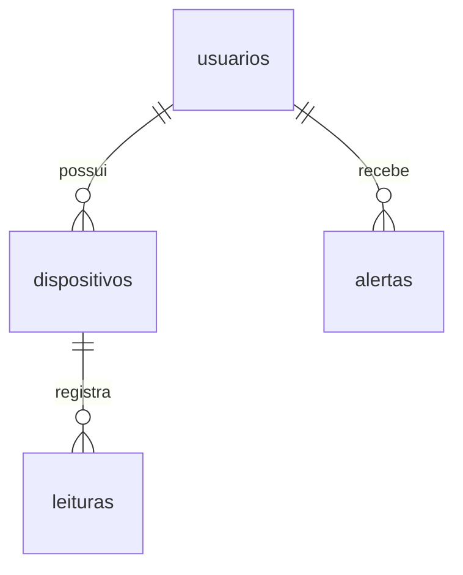

# DER

## Modelo (`database/schema.sql`)

Todas as FKs usam `ON DELETE CASCADE`. As chaves primárias são `SERIAL` (auto-incremento do PostgreSQL).

| Tabela | Descrição | Usada pelo app |
|---|---|---|
| [usuarios](Tabelas/usuarios.md) | Morador (+ `tarifa_kwh` e `meta_kwh`) | sim — busca/cria pelo e-mail |
| [dispositivos](Tabelas/dispositivos.md) | Aparelhos do usuário | sim — `DispositivoDAO` |
| [leituras](Tabelas/leituras.md) | Medições de consumo | sim — `LeituraDAO` |
| [alertas](Tabelas/alertas.md) | Avisos de meta | ainda não |

## Índices
- `idx_leituras_dispositivo (dispositivo_id)`
- `idx_leituras_data (data_hora)`
- `idx_dispositivos_usuario (usuario_id)`

## Script
Um único arquivo: `database/schema.sql`. Ele **apaga as tabelas antes de criar** (`DROP TABLE IF EXISTS`)
e insere dados de exemplo: 1 usuário (`morador@exemplo.com`) e 3 aparelhos (Geladeira, Ar-condicionado, Chuveiro).
